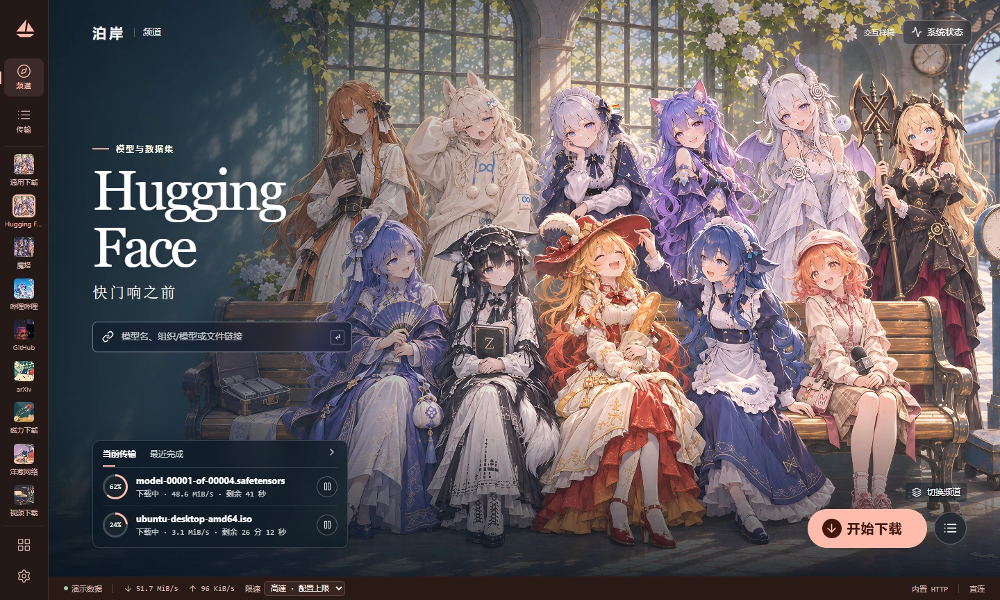
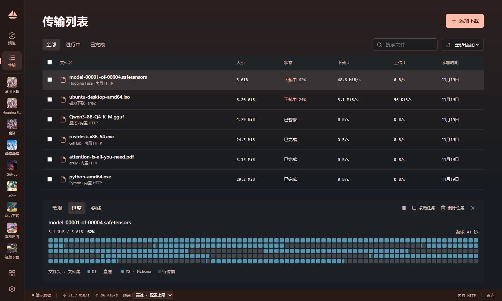

# 泊岸 · Glass Downloader

泊岸是一个 Windows 优先的本地下载工作台。下载 GitHub 项目时可以直接填 `作者/仓库`，下载 Hugging Face 模型时可以填模型名，下载 B 站视频时可以把分享文案整段贴进去。每个频道记住自己的下载核心、文件来源和代理出口，所有任务共用一张传输表。



**[快速开始](#快速开始) · [输入示例](#可以直接输入什么) · [本地 API](docs/api.md) · [参与开发](CONTRIBUTING.md) · [场景与署名](ASSETS.md)**

## 快速开始

**Windows 10/11 x64**：[下载泊岸单文件版（.exe）](https://github.com/zararogers338-hash/glass-downloader/releases/download/v0.1.1/GlassDownloader-0.1.1-windows-x64.exe)，保存到任意目录后双击打开。EXE 内含下载服务、Python 运行时、Svelte 界面、Tauri 桌面窗口、yt-dlp 和原版 12 张场景壁纸；窗口使用系统的 [WebView2 Runtime](https://developer.microsoft.com/microsoft-edge/webview2/)。同一发布页提供 SHA-256 和第三方许可清单。

单文件版的任务和设置保存在 `%LOCALAPPDATA%\GlassDownloader`。重复双击会唤起工作台；关闭窗口后，有任务时继续传输，队列空闲后自动退出。FFmpeg（音视频合并）、aria2、BBDown 为可选外部工具。可将可执行文件放进 PATH，或放入 `%LOCALAPPDATA%\GlassDownloader\components`；使用 FFmpeg 时将 ffmpeg.exe 和 ffprobe.exe 放在一起。

### 从源码运行

Windows 源码版需要 **Python 3.11 或更高版本、Node.js 22.12 或更高版本及 npm**。首次启动需要联网安装依赖。

```powershell
git clone https://github.com/zararogers338-hash/glass-downloader.git
cd glass-downloader
.\start.cmd
```

启动脚本创建项目虚拟环境、构建前端并打开工作台。源码版优先使用已构建的 Tauri 窗口，其次使用 Edge 应用窗口或默认浏览器。第一次可以切到 **GitHub**，输入 `octocat/Hello-World` 并回车。完成后在任务的「常规」页打开保存目录，即可看到默认分支的源码 ZIP。

默认文件保存在 `~/Downloads/GlassDownloader`。关掉界面后服务继续管理队列，在启动终端按 Ctrl+C 可退出。需要 Windows 原生壳时，安装 Rust、MSVC 构建工具和 WebView2，运行 `.\tools\build-desktop.ps1` 后再启动。

## 可以直接输入什么

| 频道 | 输入 | 默认结果 |
| --- | --- | --- |
| 通用下载 | HTTP(S) 文件直链 | 下载文件；服务器支持时使用多连接、断点续传 |
| Hugging Face | `hf-internal-testing/tiny-random-bert` | 固定到一个提交版本，整仓下载并保留目录结构。文件直链只下载该文件 |
| 魔搭 | `Qwen/Qwen2.5-0.5B-Instruct` | 获取公开仓库清单，按清单版本下载文件 |
| GitHub | `octocat/Hello-World` 或 Release 资产链接 | 分别得到源码 ZIP 或该资产。只输仓库短名时可从候选作者中选择 |
| 哔哩哔哩 | BV 号、视频网址、b23.tv 或 App 分享文案 | 选择视频或仅音频，按当前核心能获取的画质下载 |
| 磁力、通用视频 | magnet 链接、视频页面 | 分别通过 aria2 和 yt-dlp 处理 |
| arXiv、PyPI | `1706.03762`、`six==1.17.0` | 论文 PDF、指定版本的软件包 |
| Java、C/C++、Linux | `21`、`LLVM 20.1.8`、`Ubuntu 24.04` | Windows x64 JDK、LLVM 安装器或 Ubuntu 桌面 amd64 镜像 |
| 洋葱网络 | HTTP(S) 文件或 .onion 地址 | 通过已有的本地 Tor SOCKS 服务下载 |

HF 和魔搭的仓库输入会下载整个公开仓库。只需要某个权重、配置或量化版本时，贴该文件的链接即可。批量添加支持每行一个资源。

## 下载与恢复

- 默认同时运行 3 个任务，每个 HTTP 文件最多 4 条分段连接。支持 Range 且具备强 ETag 时，暂停会保留分片；继续时核对文件版本。其余情况会重新传输当前文件。
- 首页可暂停和继续任务。传输列表支持搜索、排序和批量删除。「常规」看整条进度，「进度」看按文件偏移排列的蓝色方格，「链路」看各连接负责的范围。
- 底栏可切换低、中、高三档。低速和中速分别将单任务下行限制为 1、5 MiB/s；高速沿用配置上限。HTTP 核心即时调整，外部进程在下次启动或继续时应用。
- 「设置 → 频道策略」可以指定来源、核心和出口。Mihomo 与 Tor 使用已有的本地监听端口，应用保持系统代理设置。真实 HTTP 任务当前使用单源、单出口、多连接。



## 下载核心

| 核心 | 适合的任务 | 如何取得 |
| --- | --- | --- |
| 内置 HTTP / HTTPX | 文件直链和公开模型仓库；HTTPX 可协商 HTTP/2 | 项目 Python 依赖 |
| cURL | 使用系统 libcurl 下载文件或仓库 | 从本机 PATH 检测 |
| aria2 | HTTP 文件和 BitTorrent | 可选组件 |
| yt-dlp | B 站和通用视频 | 项目 Python 依赖；合并分离的音视频轨需要 FFmpeg |
| BBDown | B 站专用备选核心 | 可选组件；当前适配器使用直连 |

Windows x64 可运行 `python tools/install-engines.py` 安装固定版本的 aria2 和 BBDown。脚本校验下载包的 SHA-256，并将程序保存到项目的 `.components`。在「设置 → 下载核心」中可以重新检测。视频可用性、清晰度和登录要求由来源站点决定。

## 给开发者

前端是 **Svelte 5 + Vite**，Windows 原生壳使用 **Tauri 2 / WebView2**。Python 服务管理 SQLite 队列、来源解析、传输和校验。界面与外部工具都使用带令牌的本地 REST / WebSocket 接口。壁纸通过场景 ID 加载，12 张定稿图以轻量 WebP 随仓库提供，通用频道和 HF 共用日间壁纸。

| 入口 | 内容 |
| --- | --- |
| `channels.json`、`engines.json` | 频道、核心能力和支持的线路 |
| `core/resolver.py`、`core/queue.py` | 输入解析、模型快照、任务生命周期 |
| `core/transfer.py`、`core/streams.py` | 分段传输、续传与哈希校验 |
| `src/`、`scene-packs/` | 工作台、频道配色和场景图片 |
| `tools/check_*.py`、`tools/check-workbench.mjs` | 简写解析、中断恢复、浏览器端到端检查 |

前端改动后运行 `npm run build`。只启动服务可用 `.\.venv\Scripts\python.exe launch.py --headless`。在 Linux/macOS 上可用 `python3 -m venv .venv`、`.venv/bin/python -m pip install -r requirements.txt`、`npm ci && npm run build` 和 `.venv/bin/python launch.py` 运行浏览器版，当前日常验证平台为 Windows。

**当前边界**：公开仓库与公开资源是第一版的主要场景。私有仓库凭据管理、同文件多镜像并发、定时计划和自动代理订阅管理仍在规划中。

## 许可

程序代码和技术文档使用 [MIT 许可证](LICENSE)。场景图、截图、角色参考、商标及外部组件的说明见 [ASSETS.md](ASSETS.md)。

